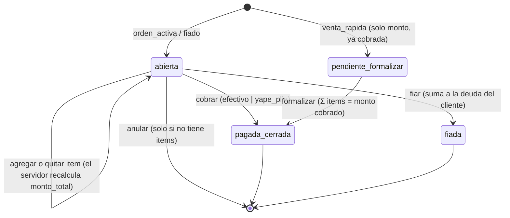
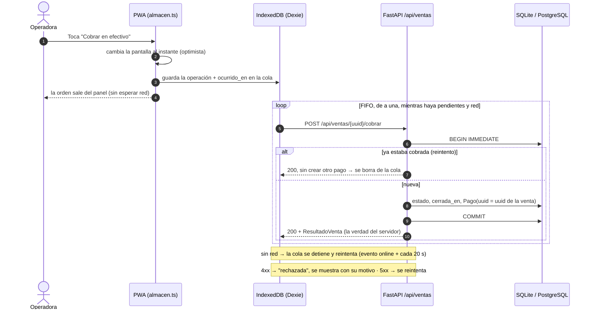
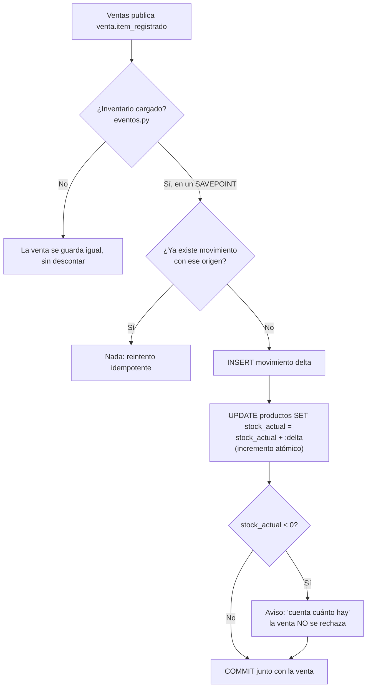
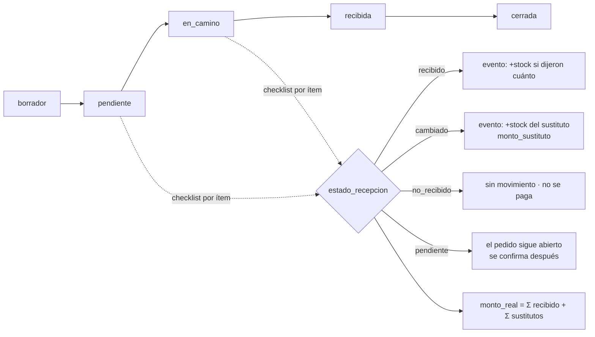
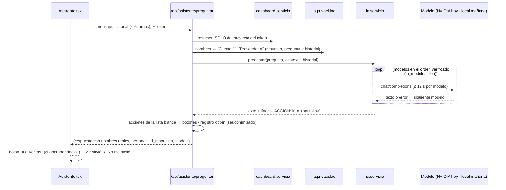
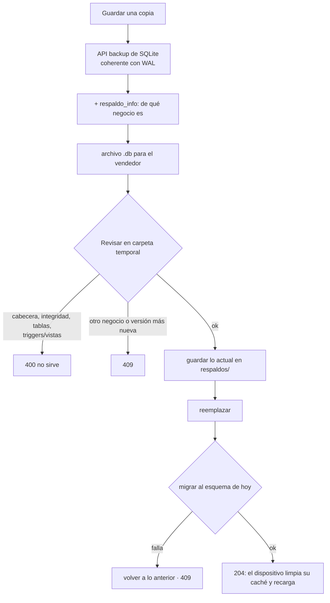

# 01 · Lógica del sistema

> Flujos transaccionales, inventario, cobro offline y Asistente. Última revisión: 2026-11-01.
> Todo lo descrito aquí está **implementado** salvo lo marcado **[Pendiente]**.
> Fuente funcional: `docs/03-modulos/Modulo-Ventas.md`, `Modulo-Inventario.md`, `docs/02-arquitectura/Sincronizacion-Offline.md`.
> Código: `backend/modules/ventas/servicio.py`, `backend/modules/inventario/servicio.py`, `frontend/src/sincronizacion/cola.ts`.

## 1. Ciclo de vida de una venta

Tres tipos (`TipoVenta`) comparten la tabla `ventas`. El estado vive en `EstadoVenta`.

Principios (los hace cumplir `servicio.py`):

1. **Totales en el servidor (D-11):** `monto_total` de orden activa y fiado es SIEMPRE Σ `items_venta.monto`, recalculado
   en la misma transacción. Un `monto` enviado por el cliente para una orden se rechaza (`422`).
2. **Lo que ocurrió no se rechaza:** una venta o un fiado son hechos físicos. Superar el límite de crédito o dejar el
   stock negativo se guarda igual y devuelve un **aviso** en palabras simples. Solo se rechazan errores de captura
   (formalizar con un detalle que no cuadra) o transiciones imposibles (cobrar una venta ya fiada).
3. **Deuda derivada:** Σ ventas `fiada` − Σ abonos (`pagos` con `cliente_id` y sin `venta_id`). Negativa = saldo a favor.
4. **"Vendiste hoy"** = ventas `pagada_cerrada` + `pendiente_formalizar` con `cerrada_en` dentro del día de Lima
   (`fechas.rango_utc_del_dia`). Un fiado no es dinero en caja: no cuenta.
5. **La hora la pone el dispositivo** (`ocurrido_en`): una venta hecha sin red a las 10:00 cuenta a las 10:00. Si la hora
   es imposible (más de 5 min en el futuro o más de 30 días atrás) se usa la del servidor (`fechas.momento_de_operacion`).

## 2. Cobro offline-first con cola idempotente (ADR-032)

La venta ocurre en la tablet aunque no haya red. Toda entidad que crea la tablet (cliente, venta, item, abono) lleva un
`uuid` generado en el dispositivo: es su identidad pública **y** su clave de idempotencia (`UNIQUE` en cada tabla).

- La respuesta del servidor reemplaza a la versión local **solo si ya no quedan operaciones pendientes de esa venta**
  (si no, un producto agregado sin red desaparecería un momento de la pantalla).
- Un `401` (sesión vencida, p. ej. al reiniciar el servidor local) **no** descarta nada: la cola espera al nuevo ingreso.
- Cada proyecto tiene su propia base IndexedDB (`mi-puestito-<proyecto>`), igual que en el servidor.

## 3. Inventario: libro mayor de movimientos (ADR-031)

El stock **no es un número que se sobreescribe**: es Σ de `movimientos_inventario`, que solo crece.

| Evento | Movimiento | Origen (único) |
|---|---|---|
| Item vendido con `producto_uuid` | `−cantidad_num` | `item_venta` + uuid del item |
| Item quitado de una orden abierta | `+` lo descontado | `item_venta_anulado` + uuid del item |
| Producto creado con stock inicial | `+stock_inicial` | `stock_inicial` + uuid del producto |
| Conteo físico | `contado − stock actual` | `ajuste` + uuid del ajuste |
| Merma / vencido | `−cantidad` | `merma` + uuid |
| Pedido recibido **[Pendiente: Fase 4 Compras]** | `+cantidad` | `recepcion` + uuid |

Garantías contra condiciones de carrera (verificadas en `tests/test_inventario.py`):

1. **Actualización perdida:** nunca "leer stock → restar en Python → escribir". El incremento es SQL atómico, y las
   escrituras abren con `BEGIN IMMEDIATE` (control negativo: sin él, 40 escrituras paralelas fallan con
   `database is locked`).
2. **Sincronización:** los movimientos son conmutativos; "gana la última escritura" queda solo para datos maestros.
3. **Reintentos:** `UNIQUE(origen_tipo, origen_ref)`.
4. **Aislamiento de módulos:** si Inventario lanza, su SAVEPOINT se deshace, la venta se confirma y el fallo aparece en
   `eventos_con_fallas` de `/api/salud`.
5. **Conciliación:** `GET /api/inventario/conciliacion` compara la caché `stock_actual` con Σ movimientos; debe estar vacía.

## 4. Recepción de compras

Código: `backend/modules/compras/servicio.py`, `frontend/src/modules/compras/`.

Reglas (ADR-045):

- **Totales en el servidor:** `monto_total` = Σ items; `monto_real` = Σ de lo que llegó de verdad. `monto_total` no cambia.
- **Solo hacia adelante:** Borrador → Pendiente → En camino. Pasa a Recibida cuando ningún ítem queda pendiente, y a
  Cerrada con "Ya le pagué". Volver atrás da `409`.
- **Una recepción confirmada no se reescribe:** ya movió stock. Reenviar la misma es un no-op (cola offline); cambiarla
  da `409`. Un error se corrige con un ajuste de Inventario.
- **Stock por evento:** `compra.item_recibido` lleva el nombre efectivo y `cantidad_stock`. Inventario suma solo con
  cantidad explícita, porque "2 packs" no dice cuántas unidades son; busca por nombre (único) y es idempotente por
  `("item_compra", uuid del ítem)`. Si no está o falla, la recepción se guarda igual.
- **Caja:** "Mañana necesitas" y "Pedidos por llegar" usan `monto_por_recibir`: tras una recepción parcial, solo lo que falta.
- **Sugerencias:** lo más pedido a ese proveedor en sus últimas 30 órdenes (sin borradores), con la cantidad y el monto de
  la última vez.
- **Offline:** proveedor, pedido, avance, recepción y cierre pasan por la misma cola FIFO que Ventas. Un RUC repetido se
  avisa en el dispositivo si ya se conoce; si no, el servidor lo rechaza con `409` y el operador lo ve en "rechazadas".

## 5. Asistente (AI Companion)

Reglas: el Asistente no inventa cifras (solo usa el resumen), nunca registra ni cobra (solo guía), y una acción sugerida
nunca se ejecuta sola (ADR-037). Sin Dashboard disponible responde igual, avisando que no tiene cifras.

**Verificador de cifras (ADR-042):** cada monto de la respuesta debe estar en el contexto o en lo que dijo el operador. Si
un modelo inventa uno, se prueba el siguiente; si todos fallan, se responde con un mensaje de respaldo y el botón a la Caja.

**Calidad medida:** `python -m ia.evaluar` corre 19 casos fijos sobre una demo temporal. Con NVIDIA el 2026-11-01:
`nemotron-3.5-bolt-e4b` 19/19 en una corrida, mediana 1,4 s, sin nombres reales hacia el proveedor en 30 llamadas (Bolt tuvo
404 intermitentes, cubiertos por los reintentos). Entre corridas hay variación: hubo 17/18 antes de añadir el caso de Compras.

**Dataset:** `python -m ia.dataset salida.jsonl` exporta solo lo valorado "Me sirvió", sin borradores, sin respuestas de
respaldo y sin cifras ausentes de su contexto. Una valoración posterior negativa saca el ejemplo.

## 6. Respaldo y restauración (ADR-044)

Código: `backend/modules/respaldo/servicio.py`, `frontend/src/componentes/barra-superior/Respaldo.tsx`.

- Recuperar no se ofrece con cambios sin enviar en la cola: se perderían.
- La copia no lleva los PIN, la llave de IA ni el secreto de sesión; va **sin cifrar** y la custodia el vendedor (D-23).

## 7. Datos de práctica

`POST /api/dashboard/demo/reiniciar` borra lo practicado y vuelve a sembrar con las fechas de hoy; con un negocio real da
`403`. El botón pide confirmación en dos pasos y limpia también lo guardado en el dispositivo, para que la cola no reenvíe
operaciones de la práctica anterior.
