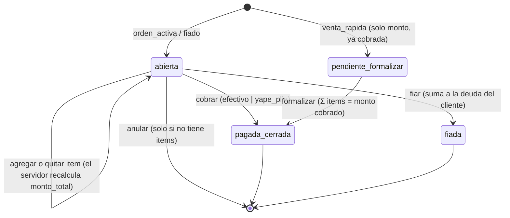
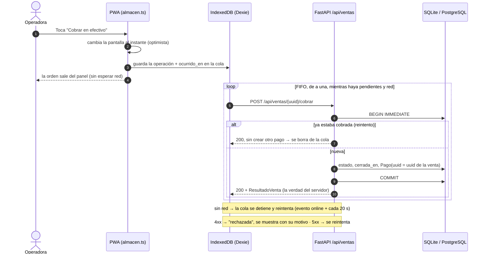
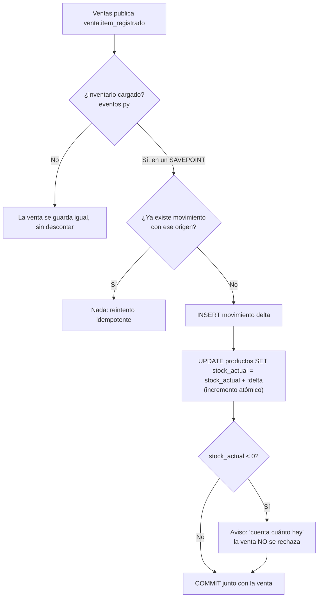
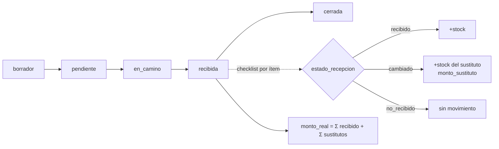

# 01 · Lógica del sistema

> Flujos transaccionales, inventario, cobro offline y Asistente. Última revisión: 2026-10-08.
> Todo lo descrito aquí está **implementado** salvo lo marcado **[Pendiente]**.
> Fuente funcional: `docs/03-modulos/Modulo-Ventas.md`, `Modulo-Inventario.md`, `docs/02-arquitectura/Sincronizacion-Offline.md`.
> Código: `backend/modules/ventas/servicio.py`, `backend/modules/inventario/servicio.py`, `frontend/src/sincronizacion/cola.ts`.

## 1. Ciclo de vida de una venta

Tres tipos (`TipoVenta`) comparten la tabla `ventas`. El estado vive en `EstadoVenta`.



Principios (los hace cumplir `servicio.py`):

1. **Totales en el servidor (D-11):** `monto_total` de orden activa y fiado es SIEMPRE Σ `items_venta.monto`, recalculado
   en la misma transacción. Un `monto` enviado por el cliente para una orden se rechaza (`422`).
2. **Lo que ocurrió no se rechaza:** una venta o un fiado son hechos físicos. Superar el límite de crédito o dejar el
   stock negativo se guarda igual y devuelve un **aviso** en palabras simples. Solo se rechazan errores de captura
   (formalizar con un detalle que no cuadra) o transiciones imposibles (cobrar una venta ya fiada).
3. **Deuda derivada:** Σ ventas `fiada` − Σ abonos (`pagos` con `cliente_id` y sin `venta_id`). Negativa = saldo a favor.
4. **"Vendiste hoy"** = ventas `pagada_cerrada` + `pendiente_formalizar` con `cerrada_en` dentro del día de Lima
   (`fechas.rango_utc_del_dia`). Un fiado no es dinero en caja: no cuenta.
5. **La hora la pone el dispositivo** (`ocurrido_en`): una venta hecha sin red a las 10:00 cuenta a las 10:00. Si la hora
   es imposible (más de 5 min en el futuro o más de 30 días atrás) se usa la del servidor (`fechas.momento_de_operacion`).

## 2. Cobro offline-first con cola idempotente (ADR-032)

La venta ocurre en la tablet aunque no haya red. Toda entidad que crea la tablet (cliente, venta, item, abono) lleva un
`uuid` generado en el dispositivo: es su identidad pública **y** su clave de idempotencia (`UNIQUE` en cada tabla).



- La respuesta del servidor reemplaza a la versión local **solo si ya no quedan operaciones pendientes de esa venta**
  (si no, un producto agregado sin red desaparecería un momento de la pantalla).
- Un `401` (sesión vencida, p. ej. al reiniciar el servidor local) **no** descarta nada: la cola espera al nuevo ingreso.
- Cada proyecto tiene su propia base IndexedDB (`mi-puestito-<proyecto>`), igual que en el servidor.

## 3. Inventario: libro mayor de movimientos (ADR-031)

El stock **no es un número que se sobreescribe**: es Σ de `movimientos_inventario`, que solo crece.

| Evento | Movimiento | Origen (único) |
|---|---|---|
| Item vendido con `producto_uuid` | `−cantidad_num` | `item_venta` + uuid del item |
| Item quitado de una orden abierta | `+` lo descontado | `item_venta_anulado` + uuid del item |
| Producto creado con stock inicial | `+stock_inicial` | `stock_inicial` + uuid del producto |
| Conteo físico | `contado − stock actual` | `ajuste` + uuid del ajuste |
| Merma / vencido | `−cantidad` | `merma` + uuid |
| Pedido recibido **[Pendiente: Fase 4 Compras]** | `+cantidad` | `recepcion` + uuid |



Garantías contra condiciones de carrera (verificadas en `tests/test_inventario.py`):

1. **Actualización perdida:** nunca "leer stock → restar en Python → escribir". El incremento es SQL atómico, y las
   escrituras abren con `BEGIN IMMEDIATE` (control negativo: sin él, 40 escrituras paralelas fallan con
   `database is locked`).
2. **Sincronización:** los movimientos son conmutativos; "gana la última escritura" queda solo para datos maestros.
3. **Reintentos:** `UNIQUE(origen_tipo, origen_ref)`.
4. **Aislamiento de módulos:** si Inventario lanza, su SAVEPOINT se deshace, la venta se confirma y el fallo aparece en
   `eventos_con_fallas` de `/api/salud`.
5. **Conciliación:** `GET /api/inventario/conciliacion` compara la caché `stock_actual` con Σ movimientos; debe estar vacía.

## 4. Recepción de compras **[Pendiente: Fase 4]**



Hoy existe el esquema y la lectura; el Dashboard ya usa los pedidos `pendiente`/`en_camino` para "Mañana necesitas en caja".

## 5. Asistente (AI Companion)

```mermaid
sequenceDiagram
    participant UI as Asistente.tsx
    participant R as /api/asistente/preguntar
    participant D as dashboard.servicio
    participant P as ia.privacidad
    participant S as ia.servicio
    participant M as Modelo (NVIDIA hoy · local mañana)
    UI->>R: {mensaje, historial (≤ 6 turnos)} + token
    R->>D: resumen SOLO del proyecto del token
    R->>P: nombres → "Cliente 1", "Proveedor A" (resumen, pregunta e historial)
    R->>S: preguntar(pregunta, contexto, historial)
    loop modelos en el orden verificado (ia_modelos.json)
        S->>M: chat/completions (≤ 12 s por modelo)
        M-->>S: texto o error → siguiente modelo
    end
    S-->>R: texto + líneas "ACCION: ir_a <pantalla>"
    R->>R: acciones de la lista blanca → botones; registro opt-in (seudonimizado)
    R-->>UI: {respuesta con nombres reales, acciones, id_respuesta, modelo}
    UI-->>UI: botón "Ir a Ventas" (el operador decide) · "Me sirvió" / "No me sirvió"
```

Reglas: el Asistente no inventa cifras (solo usa el resumen), nunca registra ni cobra (solo guía), y una acción sugerida
nunca se ejecuta sola (ADR-037). Sin Dashboard disponible responde igual, avisando que no tiene cifras.
