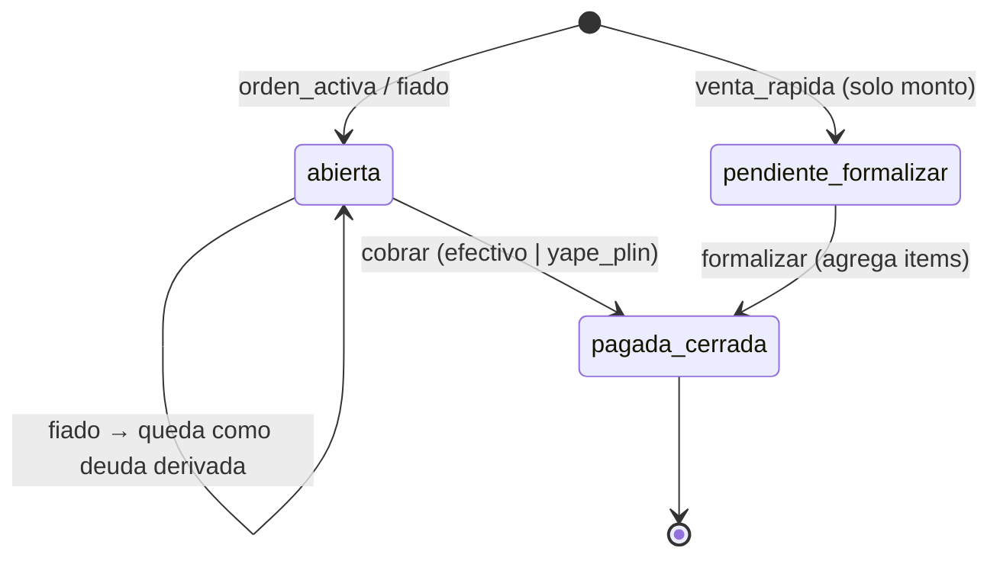
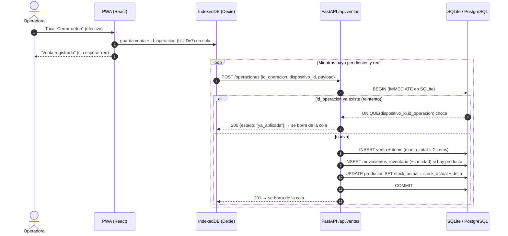
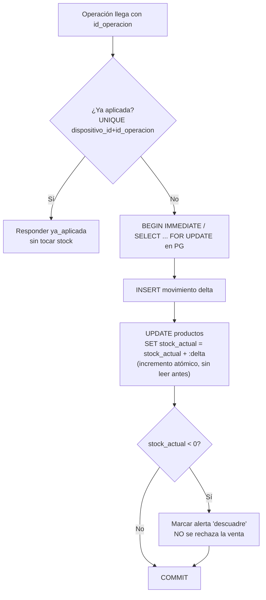
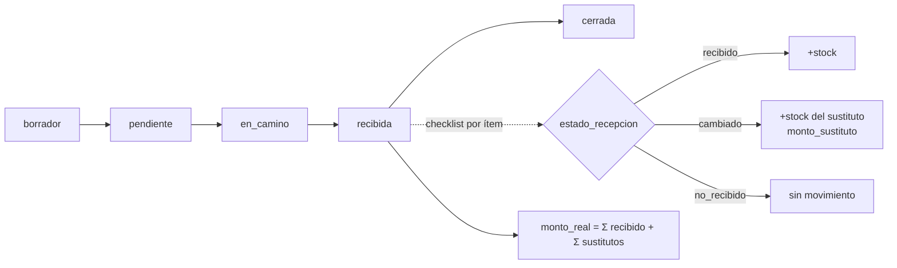
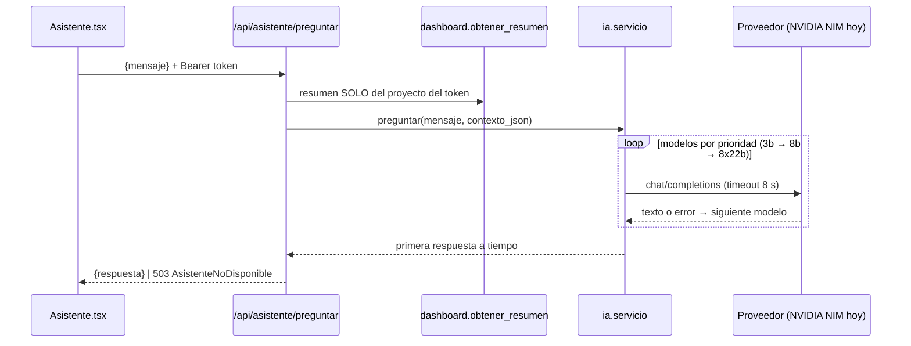

# 01 · Lógica del sistema

> Flujos transaccionales, lógica de inventario y cobro. Última revisión: 2026-09-27.
> Leyenda: **[Implementado]** existe en `main` · **[Propuesto]** diseño aprobable, aún sin código.
> Fuente funcional: `docs/03-modulos/Modulo-Ventas.md`, `Modulo-Inventario.md`, `docs/02-arquitectura/Sincronizacion-Offline.md`.

## 1. Ciclo de vida de una venta [Implementado: esquema · Propuesto: escritura]

Tres tipos (`TipoVenta`) comparten tabla `ventas`. El estado vive en `EstadoVenta`.

Reglas de integridad:

- `monto_total` **siempre** lo calcula el servidor como Σ `items_venta.monto`, en la misma transacción que inserta el item. Nunca se acepta del cliente.
- Un fiado exige `cliente_id` (`ck_fiado_requiere_cliente`).
- La deuda de un cliente se **deriva**: Σ ventas fiado − Σ pagos. No existe columna `deuda`.
- Todo `Pago` tiene destino: venta o cliente (`ck_pago_tiene_destino`).

## 2. Cobro offline-first con cola idempotente [Propuesto — ADR-032]

La venta ocurre en la tablet aunque no haya red. El servidor **no puede rechazar** una venta que ya ocurrió en el mundo físico. Solo registra y avisa.

## 3. Lógica de inventario: libro mayor de movimientos [Propuesto — ADR-031]

El stock **no es un número que se sobreescribe**. Es la suma de un libro de movimientos que solo crece.

| Evento | Movimiento | Origen |
|---|---|---|
| Compra recibida (checklist) | `+cantidad` por ítem `recibido`/`cambiado` | Compras |
| Venta con producto | `−cantidad` | Ventas |
| Conteo físico | `ajuste` = contado − calculado | Inventario |
| Merma / vencido | `−cantidad` con motivo | Inventario |

Por qué así (auditoría de condiciones de carrera):

1. **Actualización perdida**: el patrón *leer stock → restar en Python → escribir* pierde ventas cuando dos peticiones se cruzan. Se usa `stock_actual = stock_actual + :delta` en SQL, que es atómico en SQLite y PostgreSQL.
2. **Sincronización con last-write-wins** (la regla actual de `Sincronizacion-Offline.md`) destruiría los descuentos de stock hechos sin red. Los movimientos son **conmutativos**: se pueden aplicar en cualquier orden y el total es el mismo. LWW sigue siendo válido para datos maestros (nombre de cliente, precio).
3. **Doble envío por reintento**: la clave `UNIQUE(dispositivo_id, id_operacion)` hace la operación idempotente.
4. **Fuente de verdad**: `stock_actual` es una caché. Un job de conciliación recalcula `Σ movimientos` y avisa si difiere.

## 4. Recepción de compras [Implementado: esquema]

## 5. Asistente (AI Companion) en una consulta [Implementado]

