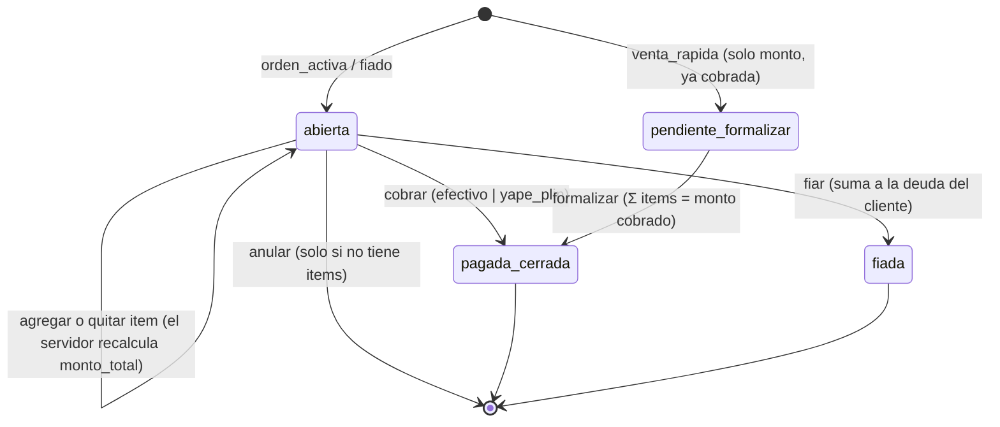
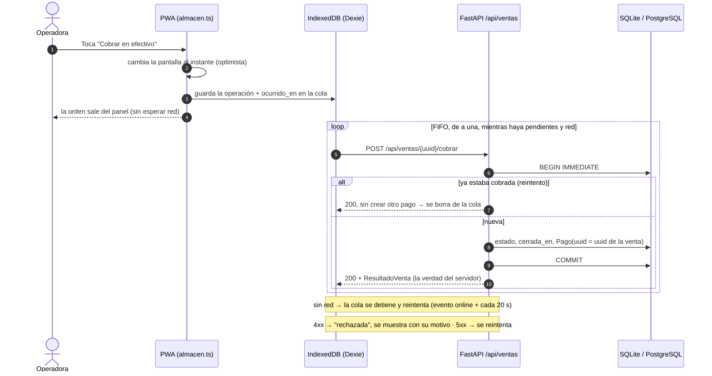
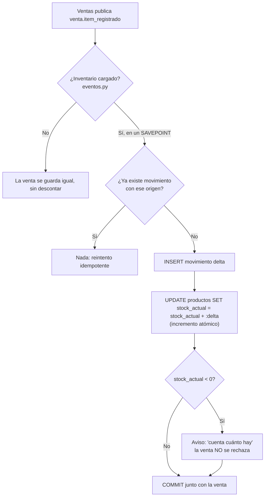
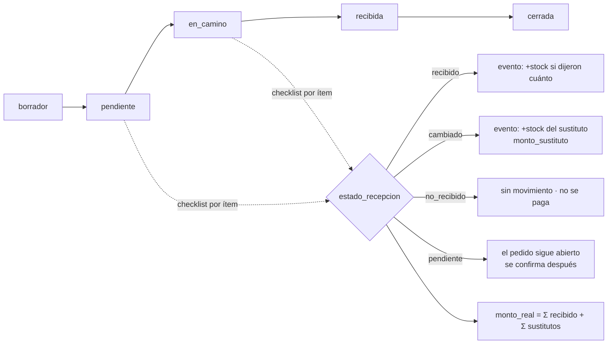
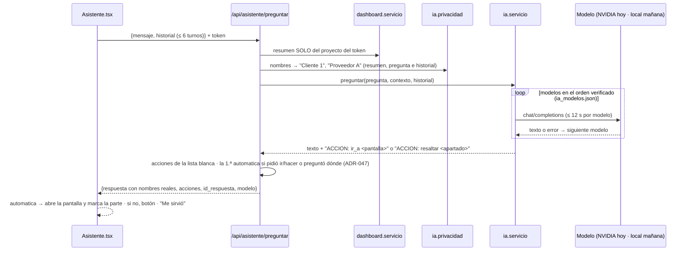
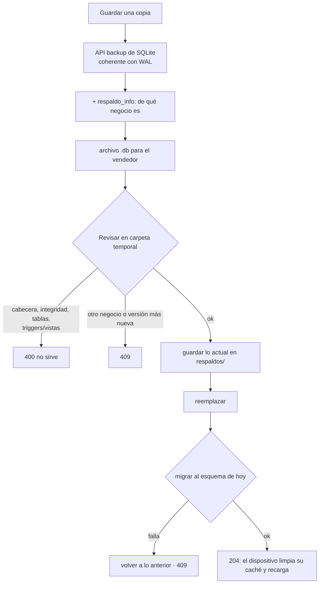
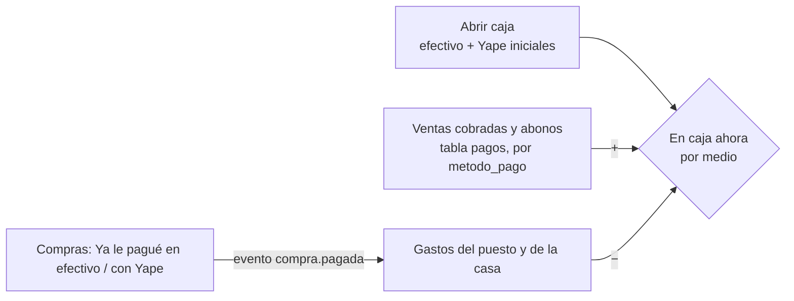

# 01 · Lógica del sistema

> Flujos transaccionales, inventario, cobro offline y Asistente. Última revisión: 2026-11-01.
> Todo lo descrito aquí está **implementado** salvo lo marcado **[Pendiente]**.
> Fuente funcional: `docs/03-modulos/Modulo-Ventas.md`, `Modulo-Inventario.md`, `docs/02-arquitectura/Sincronizacion-Offline.md`.
> Código: `backend/modules/ventas/servicio.py`, `backend/modules/inventario/servicio.py`, `frontend/src/sincronizacion/cola.ts`.

## 1. Ciclo de vida de una venta

Tres tipos (`TipoVenta`) comparten la tabla `ventas`. El estado vive en `EstadoVenta`.



Principios (los hace cumplir `servicio.py`):

1. **Totales en el servidor (D-11):** `monto_total` de orden activa y fiado es SIEMPRE Σ `items_venta.monto`, recalculado
   en la misma transacción. Un `monto` enviado por el cliente para una orden se rechaza (`422`).
2. **Lo que ocurrió no se rechaza:** una venta o un fiado son hechos físicos. Superar el límite de crédito o dejar el
   stock negativo se guarda igual y devuelve un **aviso** en palabras simples. Solo se rechazan errores de captura
   (formalizar con un detalle que no cuadra) o transiciones imposibles (cobrar una venta ya fiada).
3. **Deuda derivada:** Σ ventas `fiada` − Σ abonos (`pagos` con `cliente_id` y sin `venta_id`). Negativa = saldo a favor.
4. **"Vendiste hoy"** = ventas `pagada_cerrada` + `pendiente_formalizar` con `cerrada_en` dentro del día de Lima
   (`fechas.rango_utc_del_dia`). Un fiado no es dinero en caja: no cuenta.
5. **La hora la pone el dispositivo** (`ocurrido_en`): una venta hecha sin red a las 10:00 cuenta a las 10:00. Si la hora
   es imposible (más de 5 min en el futuro o más de 30 días atrás) se usa la del servidor (`fechas.momento_de_operacion`).

## 2. Cobro offline-first con cola idempotente (ADR-032)

La venta ocurre en la tablet aunque no haya red. Toda entidad que crea la tablet (cliente, venta, item, abono) lleva un
`uuid` generado en el dispositivo: es su identidad pública **y** su clave de idempotencia (`UNIQUE` en cada tabla).



- La respuesta del servidor reemplaza a la versión local **solo si ya no quedan operaciones pendientes de esa venta**
  (si no, un producto agregado sin red desaparecería un momento de la pantalla).
- Un `401` (sesión vencida, p. ej. al reiniciar el servidor local) **no** descarta nada: la cola espera al nuevo ingreso.
- Cada proyecto tiene su propia base IndexedDB (`mi-puestito-<proyecto>`), igual que en el servidor.

## 3. Inventario: libro mayor de movimientos (ADR-031)

El stock **no es un número que se sobreescribe**: es Σ de `movimientos_inventario`, que solo crece.

| Evento | Movimiento | Origen (único) |
|---|---|---|
| Item vendido con `producto_uuid` | `−cantidad_num` | `item_venta` + uuid del item |
| Item quitado de una orden abierta | `+` lo descontado | `item_venta_anulado` + uuid del item |
| Producto creado con stock inicial | `+stock_inicial` | `stock_inicial` + uuid del producto |
| Conteo físico | `contado − stock actual` | `ajuste` + uuid del ajuste |
| Merma / vencido | `−cantidad` | `merma` + uuid |
| Pedido recibido con cantidad (evento `compra.item_recibido`) | `+cantidad_stock` | `item_compra` + uuid del ítem |



Garantías contra condiciones de carrera (verificadas en `tests/test_inventario.py`):

1. **Actualización perdida:** nunca "leer stock → restar en Python → escribir". El incremento es SQL atómico, y las
   escrituras abren con `BEGIN IMMEDIATE` (control negativo: sin él, 40 escrituras paralelas fallan con
   `database is locked`).
2. **Sincronización:** los movimientos son conmutativos; "gana la última escritura" queda solo para datos maestros.
3. **Reintentos:** `UNIQUE(origen_tipo, origen_ref)`.
4. **Aislamiento de módulos:** si Inventario lanza, su SAVEPOINT se deshace, la venta se confirma y el fallo aparece en
   `eventos_con_fallas` de `/api/salud`.
5. **Conciliación:** `GET /api/inventario/conciliacion` compara la caché `stock_actual` con Σ movimientos; debe estar vacía.

## 4. Recepción de compras

Código: `backend/modules/compras/servicio.py`, `frontend/src/modules/compras/`.



Reglas (ADR-045):

- **Totales en el servidor:** `monto_total` = Σ items; `monto_real` = Σ de lo que llegó de verdad. `monto_total` no cambia.
- **Solo hacia adelante:** Borrador → Pendiente → En camino. Pasa a Recibida cuando ningún ítem queda pendiente, y a
  Cerrada con "Ya le pagué". Volver atrás da `409`.
- **Una recepción confirmada no se reescribe:** ya movió stock. Reenviar la misma es un no-op (cola offline); cambiarla
  da `409`. Un error se corrige con un ajuste de Inventario.
- **Stock por evento:** `compra.item_recibido` lleva el nombre efectivo y `cantidad_stock`. Inventario suma solo con
  cantidad explícita, porque "2 packs" no dice cuántas unidades son; busca por nombre (único) y es idempotente por
  `("item_compra", uuid del ítem)`. Si no está o falla, la recepción se guarda igual.
- **Caja:** "Mañana necesitas" y "Pedidos por llegar" usan `monto_por_recibir`: tras una recepción parcial, solo lo que falta.
- **Sugerencias:** lo más pedido a ese proveedor en sus últimas 30 órdenes (sin borradores), con la cantidad y el monto de
  la última vez.
- **Offline:** proveedor, pedido, avance, recepción y cierre pasan por la misma cola FIFO que Ventas. Un RUC repetido se
  avisa en el dispositivo si ya se conoce. Si dos tablets sin red lo registran, el segundo uuid queda como **alias** del
  primero (`alias_proveedores`): el alta responde `200` con el proveedor existente y sus pedidos se aceptan (D-25).

## 5. Asistente (AI Companion)



Reglas: el Asistente no inventa cifras (solo usa el resumen), nunca registra ni cobra (solo guía), y solo navega y señala:
abre una pantalla o marca una parte de ella, nunca llena ni guarda datos (ADR-037, ADR-047). Sin Dashboard disponible responde igual, avisando que no tiene cifras.

El Asistente tiene dos formas (ADR-046): **apartado propio** (pantalla `asistente` en el menú, `#asistente`) y **ventana
flotante** (botón de la barra), que queda sobre la pantalla actual y sigue abierta al navegar: si sugiere "Ir a Fiados" y
el operador lo toca, Fiados aparece detrás de la ventana. Ambas comparten la conversación de `stores/conversacion.ts`,
separada por negocio y solo en memoria: nunca se guarda en el dispositivo. Al empezar ofrece preguntas sugeridas.

**Trabajar con el Asistente a la vista (ADR-047).** La ventana va junto a la pantalla, no encima: en pantalla ancha (o
teléfono acostado) es una columna a la derecha; en teléfono y tablet de pie, una hoja abajo que se **achica** a su barra,
y el contenido gana espacio al final para que todo campo quede por encima. Llevar a otra pantalla desde el apartado pasa
la conversación a la ventana (`llevarConAsistente`): nunca se pierde de vista. La app actúa sola solo en dos casos, que
decide una regla fija sobre lo que escribió el operador (`ia/acciones.py`, nunca el modelo):

| El operador… | Ejemplo | La app |
|---|---|---|
| pide ir o hacer algo | "Quiero registrar una compra" | abre Compras con el Asistente al lado: "Abrí Compras. Sigo aquí…" |
| pregunta dónde está algo o qué tocar | "¿Qué botón toco para hacer un pedido?" | abre la pantalla y **marca** `compras.nuevo-pedido` 4 s |
| pregunta una cifra o cómo se hace algo | "¿Qué pedido llega mañana?" | solo deja el botón ("Ir a…", "Muéstrame…") |

El modelo señala con `ACCION: resaltar <apartado>`: el apartado es un `data-ai-id` real de la lista blanca `APARTADOS`
(16 partes, solo lo visible al abrir cada pantalla; un test verifica que existan en el frontend). La app lo trae a la
vista debajo de la barra y lo marca con el color del Asistente (`componentes/asistente/senalar.ts`). En la pantalla abierta
solo se marca si esa parte está dibujada en ese momento, y el aviso dice solo lo que pasó. El backend recibe además
`pantalla_actual` para decir "toca este botón" donde el operador está.

La regla que decide qué hace sola la app reconoce **toda forma del verbo** ("registrar", "anota", "regístrala por mí",
"¿cómo registro…?"), excepto el pasado ("dime que ya registraste…"). Una pregunta de cifras ("¿cuánto vendí hoy?") no
mueve nada. Ante "¿cómo…?" el Asistente da los pasos con los nombres de los botones y ofrece hacerlo.

**El Asistente llena la orden; el operador la guarda (ADR-049).** Si el operador pide registrar una venta y dice qué
lleva, el modelo escribe una línea por producto y, si dijo para quién, una línea `PARA`:

```
VENTA: 1 x Arroz Costeño
PARA: Sra. Bertha
```

`ia/borrador.py` la lee (tolera "1 kg x", "1 kilo de" y precios de relleno como `a <precio>`) y la app abre Ventas con la
tarjeta **"El Asistente llenó esta orden"**: nombre de la orden, producto, cantidad y precio, todo editable, y nada
guardado hasta tocar **«Guardar orden»**. Invariantes, ninguna depende del modelo:

- Solo hay orden llenada si el operador pidió registrar, en este mensaje o en el anterior ("regístrala por mí").
- **Un precio que el operador no dijo se descarta**: la línea queda con el precio del inventario, o en blanco.
- Cada línea se enlaza con su producto si el nombre calza, sin importar mayúsculas, tildes ni plurales
  (`inventario/nombres.ts`): así descuenta stock al guardarse.
- Si el texto del modelo habla de "revisa la orden" y no hay orden llenada, se reemplaza por un pedido de los productos:
  el operador nunca busca una orden que no existe. Ninguna línea de control (`ACCION`, `VENTA`, `PARA`) llega a la pantalla.
- El verificador de cifras acepta también el **producto** de dos cifras del operador (2 × 4.80 = 9.60).

Para escribir bien los nombres, el modelo recibe `productos_del_inventario`: solo los nombres, sin stock ni precios.
En la conversación, cada producto del inventario que se nombra (lo diga el Asistente o el operador) es un **enlace** a su
tarjeta en Inventario, que se abre y se marca. Se le puede **hablar** al Asistente (botón «Hablar»): el dictado del
navegador escribe lo entendido mientras se habla y lo envía al terminar.

**Verificador de cifras (ADR-042):** cada monto de la respuesta debe estar en el contexto o en lo que dijo el operador. Si
un modelo inventa uno, se prueba el siguiente; si todos fallan, se responde con un mensaje de respaldo y el botón a la Caja.

**Calidad medida:** `python -m ia.evaluar` corre 19 casos fijos sobre una demo temporal. Con NVIDIA el 2026-11-01:
`nemotron-3.5-bolt-e4b` 19/19 en una corrida, mediana 1,4 s, sin nombres reales hacia el proveedor en 30 llamadas (Bolt tuvo
404 intermitentes, cubiertos por los reintentos). Entre corridas hay variación: hubo 17/18 antes de añadir el caso de Compras.
El 2026-11-07, con la pantalla de Inventario en la guía: 18/19 y 19/19, mediana 1,2 s. El fallo intermitente es "cómo
cobrar" sin nombrar el botón. Nombrar "reportes" en la guía hacía que el modelo los mencionara; ahora la guía dice
que solo hay cifras de hoy. El Asistente no ve el stock: ante "¿cuánto arroz me queda?" ofrece ir a Inventario.

**Dataset:** `python -m ia.dataset salida.jsonl` exporta solo lo valorado "Me sirvió", sin borradores, sin respuestas de
respaldo y sin cifras ausentes de su contexto. Una valoración posterior negativa saca el ejemplo.

## 6. Respaldo y restauración (ADR-044)

Código: `backend/modules/respaldo/servicio.py`, `frontend/src/componentes/barra-superior/Respaldo.tsx`.



- Recuperar no se ofrece con cambios sin enviar en la cola: se perderían.
- La copia no lleva los PIN, la llave de IA ni el secreto de sesión; va **sin cifrar** y la custodia el vendedor (D-23).

## 7. Inventario en pantalla

Código: `frontend/src/modules/inventario/`. El stock no se escribe a mano: **Contar lo que hay** envía cuánto hay y el
servidor calcula la diferencia (ADR-031); **Registrar merma** resta; las ventas con `producto_uuid` y las compras
recibidas con cantidad lo mueven solas. Las cantidades viajan con 3 decimales y en el frontend se llevan en milésimas
enteras, igual que el dinero en céntimos. Todo pasa por la cola offline; "Queda poco" y "Descuadre" se dicen con
palabras, calculados igual que `_con_estado` del backend.

**Vender un producto del inventario:** al escribir el producto en una venta aparecen los que coinciden. Al elegir uno,
la cantidad se pide en su unidad y el monto se sugiere con `montoPorCantidad` (precio × cantidad, redondeado al céntimo;
el operador puede cambiarlo). El ítem viaja con `producto_uuid` y `cantidad_num`, y el servidor descuenta por el evento
`venta.item_registrado`; quitar el ítem lo devuelve. La pantalla refleja el stock al instante con `ajustarLocal`, que no
encola nada. Sin elegir, se vende con texto libre y el stock no cambia.

## 8. Datos de práctica

`POST /api/dashboard/demo/reiniciar` borra lo practicado y vuelve a sembrar con las fechas de hoy; con un negocio real da
`403`. El botón pide confirmación en dos pasos y limpia también lo guardado en el dispositivo, para que la cola no reenvíe
operaciones de la práctica anterior.

## 9. Caja con saldo inicial y Gastos (ADR-051)

Código: `backend/modules/caja/`, `backend/modules/gastos/`, `frontend/src/modules/dashboard/EnCaja.tsx`,
`frontend/src/modules/gastos/`. Decisión del owner (2026-11-17): la caja empieza siempre con un saldo en efectivo y
otro en Yape.



- **En caja = inicial + ingresos − egresos**, por separado en efectivo y en Yape. Un fiado no es dinero: no entra hasta
  que se abona. El día es el peruano (`rango_utc_del_dia`); la hora de cada operación la pone el dispositivo.
- **Una apertura por día**: repetirla corrige los saldos (dato maestro, gana la última). Si la caja no se abrió, se
  muestra el formulario "¿Con cuánto empiezas hoy?" y todo cuenta desde cero.
- **Gastos**: monto, de dónde salió (gaveta o Yape), si es del puesto o de la casa, y su categoría. Separar el puesto de
  la casa es lo que deja ver si el negocio gana (Modulo-Gastos.md). Idempotentes por `uuid`; borrar uno mal anotado lo
  elimina.
- **Pagar un pedido**: "Ya le pagué en efectivo / con Yape" cierra el pedido y publica `compra.pagada` con `monto_real`.
  Gastos lo anota una sola vez por pedido (`orden_compra_uuid` único). Sin Gastos, el pedido se cierra igual.
- **Aislamiento**: la Caja lee Ventas y Gastos dentro de un `try`; si uno falla, esa parte queda en cero y se dice en
  `no_disponibles`.
- **El Asistente** recibe `caja_abierta` y `en_caja` en su contexto: "¿cuánto tengo en efectivo?" se responde con la cifra
  real. Lleva a Gastos ("quiero anotar un gasto") y corrige hacia Gastos un "Ir a la Caja" cuando se habla de gastos.

## 10. Costo, vencimientos y código de barras (D-22)

- **Costo de la última compra**: al recibir un pedido con cantidad (`compra.item_recibido`), Inventario guarda
  `costo_ultimo = monto ÷ cantidad`, redondeado al céntimo, solo si el movimiento es nuevo (un reenvío no lo cambia). La
  tarjeta dice "Costó S/ 3.60 · ganas S/ 0.60 por unidad" (en rojo si se vende por debajo del costo).
- **Vencimiento**: cada producto guarda la fecha del lote que vence primero y aún no venció (`vence_el`). Un lote nuevo
  la cambia si es más temprano, o si la guardada ya pasó. Se corrige o se borra a mano ("ya no queda ese lote").
  `vence_pronto` = vence en 7 días o menos (o ya venció) **y queda stock**; `vencido` = ya pasó. La Caja de hoy avisa
  cuántos hay (`productos_por_vencer`) y lleva a Inventario.
- **Código de barras**: se guarda al crear el producto y la búsqueda acepta el código exacto: un lector USB o Bluetooth
  lo "escribe" en el buscador. Escanear con la cámara queda pendiente (D-30).
