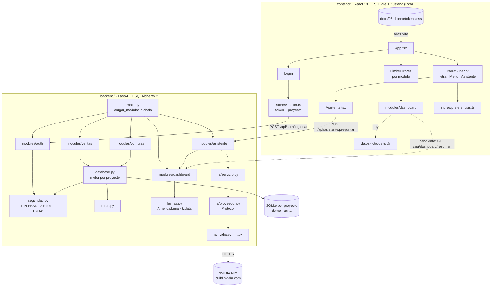
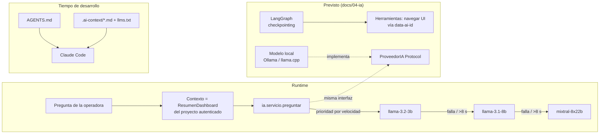

# 02 · Arquitectura

> Dependencias frontend/backend e integración de IA. Última revisión: 2026-09-27.
> Stack oficial en `AGENTS.md` y `docs/02-arquitectura/Stack-Tecnologico.md`.

## 1. Vista de despliegue: Staging y Producción

| Entorno | Dónde corre | Base de datos | Variables | Cómo se valida |
|---|---|---|---|---|
| **Staging** | Máquina del desarrollador: `uvicorn --reload` + `vite` dev server | Un SQLite por proyecto en `backend/` (ignorado por git) | `config/.env.staging` (ignorado) | `pytest` + `npm run test` + build del `.exe` y humo en `/api/salud` |
| **Producción** | `MiPuestito.exe` en la PC/tablet del puesto (127.0.0.1) · nube PostgreSQL a futuro | `%LOCALAPPDATA%\MiPuestito\mi_puestito_<proyecto>.db` | Variables del sistema o `config/.env.production` (ignorado) | CI `Ejecutable Windows`: exige `modulos_degradados == []` |

Regla: toda función que toque dinero o stock se prueba primero en Staging con el proyecto **demo**. El proyecto **anita** (datos reales) solo recibe código ya verificado.

## 2. Dependencias de módulos

Observaciones:

- `MAsi → MDash` es la **única dependencia cruzada entre módulos**. Si Dashboard no carga, Asistente tampoco (ver deuda D-06).
- `database.py → seguridad.py`: la sesión de BD se elige por el proyecto del token. Una petición nunca puede tocar la BD de otro proyecto.
- El Dashboard del frontend todavía no consume el API (deuda D-01).

## 3. Capa de IA (AI-first, agnóstica)

- **Regla no negociable**: ningún módulo fuera de `ia/` importa un cliente de proveedor. Cambiar de NVIDIA a un modelo local es una clase nueva que cumple `ProveedorIA`.
- **Contexto mínimo**: el Asistente solo recibe el resumen del proyecto autenticado. Nombres de clientes viajan a un tercero (deuda D-05, ADR-034).
- **Contexto de desarrollo**: `AGENTS.md` (fuente de verdad) + `.ai-context/` (arquitectura viva, solo técnica) + `docs/` (bóveda Obsidian).

## 4. Seguridad por capas

| Capa | Mecanismo | Archivo |
|---|---|---|
| Red | Solo escucha en `127.0.0.1` | `escritorio.py` |
| Identidad | Usuario + PIN (PBKDF2-SHA256, 100k iteraciones, sal por usuario) | `seguridad.py` |
| Sesión | Token `proyecto:vence:HMAC` de 12 h | `seguridad.py` |
| Aislamiento de datos | Un archivo SQLite por proyecto, elegido por el token | `database.py`, `rutas.py` |
| Repo público | `.gitignore` + `tests/test_higiene_repo.py` en CI | raíz, `backend/tests` |
