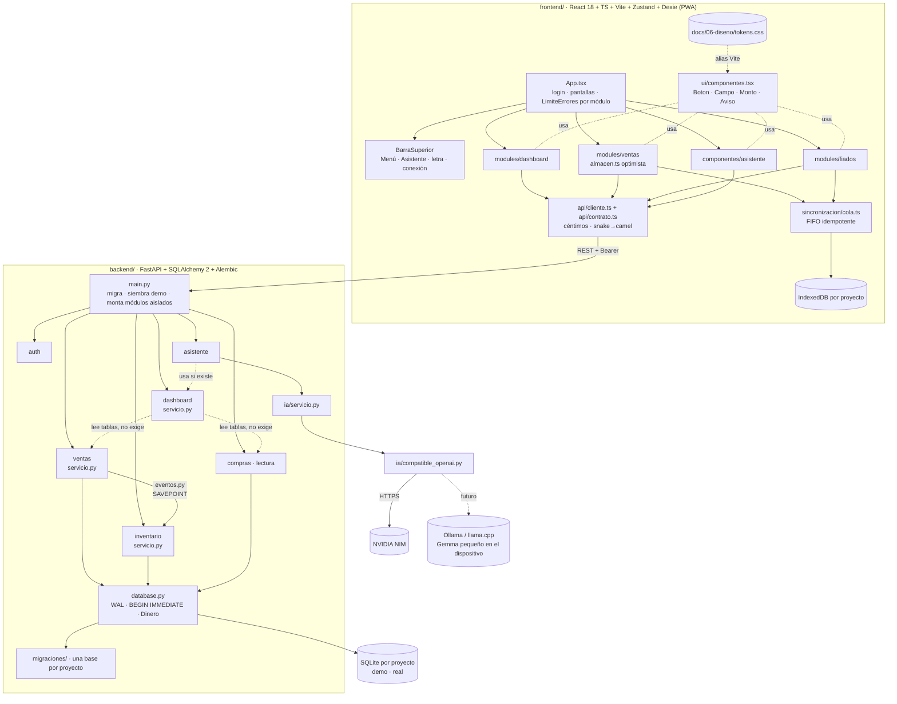
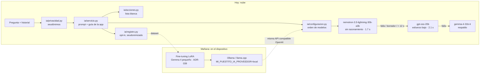

# 02 · Arquitectura

> Entornos, dependencias, capa de IA y seguridad. Última revisión: 2026-10-08.
> Stack oficial en `AGENTS.md` y `docs/02-arquitectura/Stack-Tecnologico.md`.

## 1. Entornos: Staging y Producción

| Entorno | Dónde corre | Datos | Configuración | Cómo se valida |
|---|---|---|---|---|
| **Staging** | PC del desarrollador: `scripts/staging-con-ia.ps1` (uvicorn sirve API + frontend construido) o `uvicorn --reload` + Vite | `MI_PUESTITO_DATOS` → `%LOCALAPPDATA%\MiPuestito-staging` (nunca dentro del repo) | Variables de la ventana; llave de NVIDIA solo en memoria o en la variable de usuario de Windows | `pytest`, `ruff`, `npm run lint/test/build`, navegador con el proyecto **demo** |
| **Producción local** | `MiPuestito.exe` en la PC/tablet del puesto, solo `127.0.0.1` | `%LOCALAPPDATA%\MiPuestito\` (un SQLite por proyecto) | Variables del sistema | CI `Ejecutable Windows`: humo exige `modulos_degradados == []` |
| **Producción nube** *(futuro)* | Servidor con PostgreSQL | URL en `MI_PUESTITO_BD` | `MI_PUESTITO_ENTORNO=production` exige `MI_PUESTITO_SECRETO` ≥ 32 caracteres | Igual que Staging + migraciones con Alembic |

Regla: todo lo que toca dinero o stock se prueba primero en Staging con **demo**. El negocio real solo recibe código ya
verificado. Las dependencias pesadas (venv, `node_modules`) nunca van en la carpeta de Google Drive.

## 2. Dependencias de módulos

- **Sin dependencias cruzadas obligatorias:** Ventas no conoce a Inventario (le avisa por `eventos.py`); el Dashboard
  lee tablas de Ventas y Compras dentro de `try` y marca `secciones_no_disponibles`; el Asistente importa el servicio
  del Dashboard de forma perezosa y responde sin cifras si falla (D-06 resuelto).
- **Estilos aislados:** cada módulo usa `*.module.css`; el único CSS global es el reset `estilos-base.css`
  (`frontend/src/pruebas/estilos-aislados.test.ts` lo vigila). Colores y tamaños solo desde tokens.
- **Contrato:** `backend/exportar_openapi.py` → `frontend/src/api/openapi.json`, comparado por `backend/tests/test_contrato.py`
  y `frontend/src/api/contrato.test.ts`.

## 3. Capa de IA (AI-first, agnóstica · ADR-036/037/038)

- **Un solo cliente HTTP** (`httpx`, sin SDK de proveedores) para cualquier API compatible con OpenAI: NVIDIA NIM hoy;
  Ollama, llama.cpp, vLLM o LM Studio mañana. Cambiar de nube a local es cambiar `MI_PUESTITO_IA_PROVEEDOR`/`_URL`.
- **Modelos verificados:** `python -m ia.verificar` prueba los candidatos con la llave del operador y el prompt real,
  y escribe `ia_modelos.json` (solo nombres y latencias): primero los que responden bien, luego por velocidad. Los modelos
  de razonamiento llevan su ajuste para responder directo; una respuesta que sea un borrador se descarta. Gemma 4 es la
  familia objetivo del modelo local y queda de respaldo hasta que responda a tiempo en NVIDIA.
- **Acciones:** el modelo propone `ACCION: ir_a <pantalla>`; solo pasan `caja`, `ventas`, `fiados`, y se muestran como
  botones que el operador decide tocar. El Asistente nunca registra, cobra ni navega solo.
- **Contexto de desarrollo:** `AGENTS.md` (fuente de verdad) + `.ai-context/` + `docs/` + subagente revisor en
  `.claude/agents/revisor.md` (solo lectura, bajo demanda).

## 4. Seguridad por capas

| Capa | Mecanismo | Archivo |
|---|---|---|
| Red | Solo escucha en `127.0.0.1` | `backend/escritorio.py` |
| Identidad | Usuario + PIN (PBKDF2-SHA256, 100k iteraciones, sal por usuario); 5 fallos → espera exponencial | `backend/seguridad.py` |
| Sesión | Token `proyecto:vence:HMAC` de 12 h; en `production` el secreto es obligatorio | `backend/seguridad.py` |
| Aislamiento de datos | Un SQLite y una IndexedDB por proyecto, elegidos por el token | `backend/database.py`, `frontend/src/sincronizacion/base-local.ts` |
| Datos personales hacia IA | Seudonimización de resumen, pregunta e historial | `backend/ia/privacidad.py` |
| Llave de IA | Solo variable de entorno (ventana o usuario de Windows); nunca en archivos del proyecto | `scripts/staging-con-ia.ps1`, `backend/ia/configuracion.py` |
| Repo público | `.gitignore` + `backend/tests/test_higiene_repo.py` en CI; permisos de Claude Code niegan leer `.env`, bases y registros | `.gitignore`, `.claude/settings.json` |
