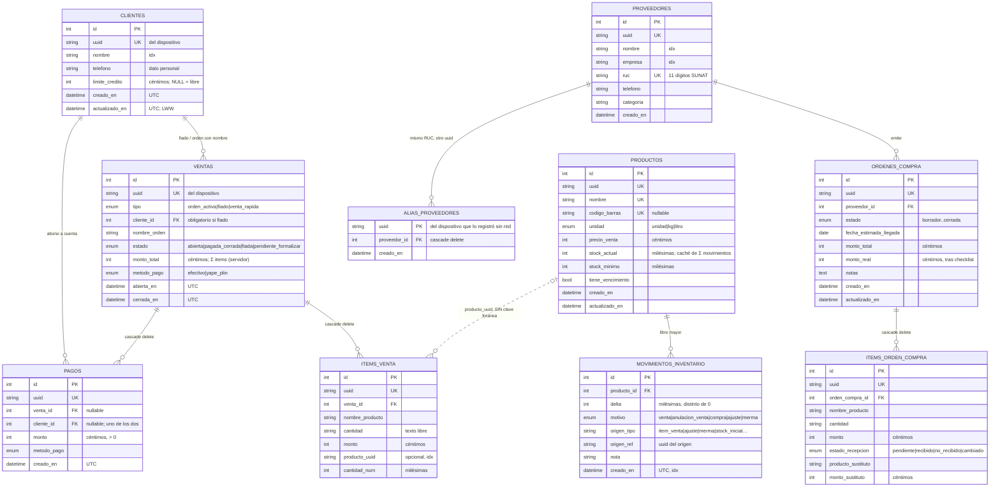

# 03 · Base de datos

> Modelo entidad-relación y diccionario de datos. Última revisión: 2026-11-01.
> Fuente de verdad del esquema: `backend/modules/*/models.py`; historial en `backend/migraciones/versions/` (0001–0005).
> Un archivo SQLite **por proyecto** (`mi_puestito_demo.db`, `mi_puestito_<real>.db`), mismo esquema en cada uno.
> `backend/tests/test_migraciones.py` falla si un modelo cambia sin su migración.

## 1. Diagrama ER

## 2. Fuera de la base de datos

| Qué | Dónde | Contenido | Protección |
|---|---|---|---|
| Usuarios | `usuarios.json` en la carpeta de datos | `{usuario: {proyecto, sal, pin_hash}}` | `.gitignore` + `test_higiene_repo.py` |
| Orden de modelos de IA | `ia_modelos.json` en la carpeta de datos | Nombres de modelos, latencias, fecha. **Nunca la llave** | Se regenera con `python -m ia.verificar` |
| Registro para fine-tuning | `ia_registro_<proyecto>.jsonl` en la carpeta de datos | Intercambios en formato chat, seudonimizados, y valoraciones (ADR-038) | Opt-in; `*.jsonl` ignorado y vigilado |
| Cola offline | IndexedDB `mi-puestito-<proyecto>` en el navegador | `operaciones`, `ventasAbiertas`, `clientes`, `instantaneas`, `ordenesCompra`, `proveedores` | Por proyecto; vive en el dispositivo |
| Secreto de sesión | `sesion.key` en la carpeta de datos | Firma los tokens en modo local | `*.key` en `.gitignore` y en el test de higiene |
| Llave de IA | `ia_llave.dpapi` en la carpeta de datos | Cifrada con DPAPI, ligada a la cuenta de Windows (ADR-043) | `*.dpapi` en `.gitignore` y en el test de higiene |
| Copias automáticas | `respaldos/antes-de-restaurar-<proyecto>-<momento>.db` en la carpeta de datos | Lo que había antes de cada restauración (ADR-044) | `*.db` y `respaldos/` en `.gitignore`. No se borran solas |

## 3. Diccionario de datos

| Tabla.columna | Tipo SQL | Nulo | Restricción / índice | Significado |
|---|---|---|---|---|
| `*.uuid` | VARCHAR(36) | no | `uq_<tabla>_uuid` | Identidad pública y clave de idempotencia (ADR-032) |
| `clientes.nombre` | VARCHAR(120) | no | `ix_clientes_nombre` | Búsqueda al fiar |
| `clientes.telefono` | VARCHAR(20) | sí | — | **Dato personal** (Ley 29733) |
| `clientes.limite_credito` | INTEGER | sí | — | Céntimos; NULL = crédito libre. Superarlo avisa, no bloquea |
| `ventas.estado` | VARCHAR enum | no | `ix_ventas_estado_abierta_en`, `ix_ventas_estado_cerrada_en` | Ciclo de la venta |
| `ventas.cliente_id` | INT FK | sí | `ck_fiado_requiere_cliente` | Obligatorio en fiado |
| `ventas.monto_total` | INTEGER | no | `ck_venta_monto_no_negativo` | Céntimos. Orden/fiado: Σ items; venta rápida: lo cobrado |
| `items_venta.monto` | INTEGER | no | `ck_item_venta_monto_no_negativo` | Céntimos |
| `items_venta.producto_uuid` | VARCHAR(36) | sí | `ix_items_venta_producto_uuid` | Enlace blando a Inventario: sin FK entre módulos |
| `items_venta.cantidad_num` | INTEGER | sí | — | Milésimas; lo que se descuenta del stock |
| `pagos.venta_id` / `cliente_id` | INT FK | sí | `ck_pago_tiene_destino` | Pago de venta o abono a cuenta |
| `pagos.monto` | INTEGER | no | `ck_pago_monto_positivo` | Céntimos |
| `proveedores.ruc` | VARCHAR(11) | sí | `uq_proveedores_ruc` | Evita duplicados al autorregistrarse |
| `alias_proveedores.uuid` | VARCHAR(36) | no | PK | Otro uuid del mismo proveedor; `buscar_proveedor` lo resuelve (D-25) |
| `ordenes_compra.(estado, fecha_estimada_llegada)` | enum + DATE | — | `ix_ordenes_estado_llegada` | "Mañana necesitas en caja" |
| `ordenes_compra.monto_total` | INTEGER | no | — | Céntimos, Σ items, calculado en el servidor. No cambia al recibir |
| `ordenes_compra.monto_real` | INTEGER | sí | — | Céntimos; NULL hasta la primera recepción. Σ recibido + Σ sustitutos |
| `items_orden_compra.estado_recepcion` | VARCHAR enum | no | — | Una vez distinto de `pendiente`, no se reescribe (ADR-045) |
| `productos.stock_actual` | INTEGER | no | — | Milésimas. Solo lo cambia `registrar_movimiento` (incremento atómico) |
| `movimientos_inventario.(origen_tipo, origen_ref)` | VARCHAR | no | `uq_movimiento_origen` | Un origen mueve el stock una sola vez |
| `movimientos_inventario.delta` | INTEGER | no | `ck_movimiento_delta_no_cero` | Milésimas, ± |

## 4. Convenciones

- **Dinero:** columnas `INTEGER` en céntimos vía el tipo `Dinero` (ADR-035); en Python es `Decimal`, en JSON un string
  decimal (`"485.50"`), en el frontend céntimos enteros. `SUM()` hereda el tipo: ya devuelve soles.
- **Cantidades:** tipo `Cantidad`, milésimas enteras (kg con 3 decimales).
- **Fechas:** `FechaHoraUTC` (UTC con zona). `America/Lima` solo al presentar o al definir "hoy".
- **Nombres de índices y únicos:** convención en `Base.metadata` (`ix_…`, `uq_<tabla>_<columna>`), para que Alembic pueda
  migrarlos.
- **Migraciones:** `backend/migraciones/ejecutar.py` migra cada proyecto al arrancar. Una base sin `alembic_version`
  (creada con `create_all` en la Demo 1) se marca en 0001. Las claves foráneas se apagan durante la migración para que
  el modo batch de SQLite no dispare `ON DELETE CASCADE`, y `PRAGMA foreign_key_check` lo confirma al final.
- **Concurrencia:** WAL + `busy_timeout=5000`; sesiones de escritura con `BEGIN IMMEDIATE` (D-02).
- **Sin FK entre módulos:** Ventas y Compras funcionan sin Inventario.
- **Tabla solo en copias:** `respaldo_info (proyecto, creado_en)` existe únicamente dentro del archivo de respaldo; se quita
  al restaurar y no forma parte del esquema (ADR-044).
