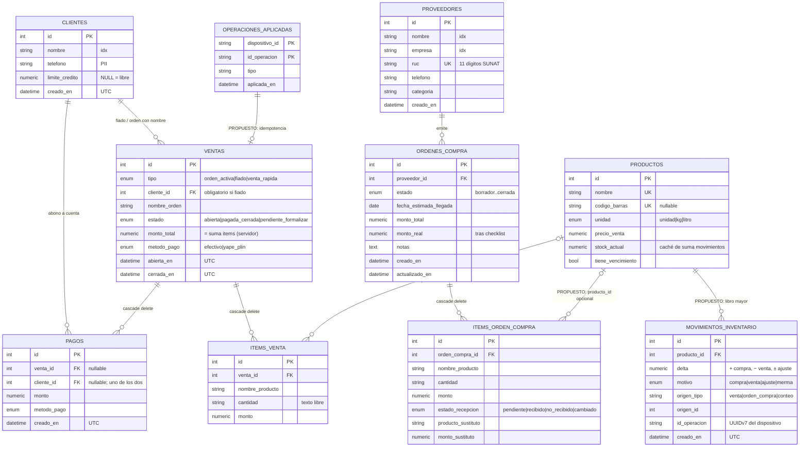

# 03 · Base de datos

> Modelo entidad-relación y diccionario de datos. Última revisión: 2026-09-27.
> Fuente de verdad del esquema: `backend/modules/*/models.py`. Tipos: SQLAlchemy 2.
> Un archivo SQLite **por proyecto** (`mi_puestito_demo.db`, `mi_puestito_anita.db`); mismo esquema en cada uno.

## 1. Diagrama ER

Las entidades marcadas `PROPUESTO` no existen todavía (ADR-031, ADR-032).

## 2. Identidad de usuarios (fuera de la BD)

Los usuarios **no** son una tabla. Viven en `usuarios.json`, en la carpeta de datos (`rutas.ruta_usuarios()`): `{usuario: {proyecto, sal, pin_hash}}`. Hay un usuario por proyecto. El archivo está en `.gitignore` y lo vigila `test_higiene_repo.py`.

## 3. Diccionario de datos

| Tabla.columna | Tipo | Nulo | Restricción / índice | Significado |
|---|---|---|---|---|
| `clientes.nombre` | VARCHAR(120) | no | `ix` | Búsqueda al registrar fiado |
| `clientes.telefono` | VARCHAR(20) | sí | — | **Dato personal** (Ley 29733) |
| `clientes.limite_credito` | NUMERIC(10,2) | sí | — | NULL = crédito libre |
| `ventas.tipo` | VARCHAR enum | no | `ix_ventas_tipo_cliente` | Tipo de venta |
| `ventas.cliente_id` | INT FK→clientes | sí | `ck_fiado_requiere_cliente` | Obligatorio en fiado |
| `ventas.estado` | VARCHAR enum | no | `ix_ventas_estado_abierta_en` | Estado del ciclo |
| `ventas.monto_total` | NUMERIC(10,2) | no | default 0 | Σ items; lo escribe el servidor |
| `ventas.abierta_en` | `FechaHoraUTC` | no | índice compuesto | Siempre UTC con zona |
| `items_venta.venta_id` | INT FK | no | `ON DELETE CASCADE`, `ix` | — |
| `items_venta.cantidad` | VARCHAR(60) | sí | — | Texto libre ("2 packs"); sin inventario |
| `pagos.venta_id` / `cliente_id` | INT FK | sí | `ck_pago_tiene_destino` | Al menos uno |
| `proveedores.ruc` | VARCHAR(11) | sí | `UNIQUE` | Evita duplicados al autorregistrarse |
| `ordenes_compra.estado` + `fecha_estimada_llegada` | enum + DATE | — | `ix_ordenes_estado_llegada` | Proyección "Mañana necesitas en caja" |
| `ordenes_compra.monto_real` | NUMERIC(10,2) | sí | — | Recalculado tras checklist |
| `movimientos_inventario.(producto_id)` | INT FK | no | `ix` | **PROPUESTO** |
| `movimientos_inventario.delta` | NUMERIC(12,3) | no | `CHECK delta <> 0` | **PROPUESTO**. Admite kg con 3 decimales |
| `operaciones_aplicadas.(dispositivo_id,id_operacion)` | VARCHAR | no | `PRIMARY KEY` compuesta | **PROPUESTO**. Idempotencia de la cola offline |

## 4. Convenciones

- **Dinero**: `NUMERIC(10,2)` + `Decimal` en Python. En JSON viaja como **string decimal** (`"485.50"`, comportamiento de Pydantic v2). El frontend lo convierte en un único adaptador (ADR-033).
- **Fechas**: `FechaHoraUTC` (UTC con zona). La zona `America/Lima` se aplica solo al presentar (`fechas.py`).
- **Migraciones**: hoy `create_all`. Alembic entra **antes** de la primera tabla nueva con datos reales en `anita` (deuda D-03).
- **Sin FK entre módulos**: Ventas y Compras no dependen de Inventario. `producto_id` será **nullable**.
