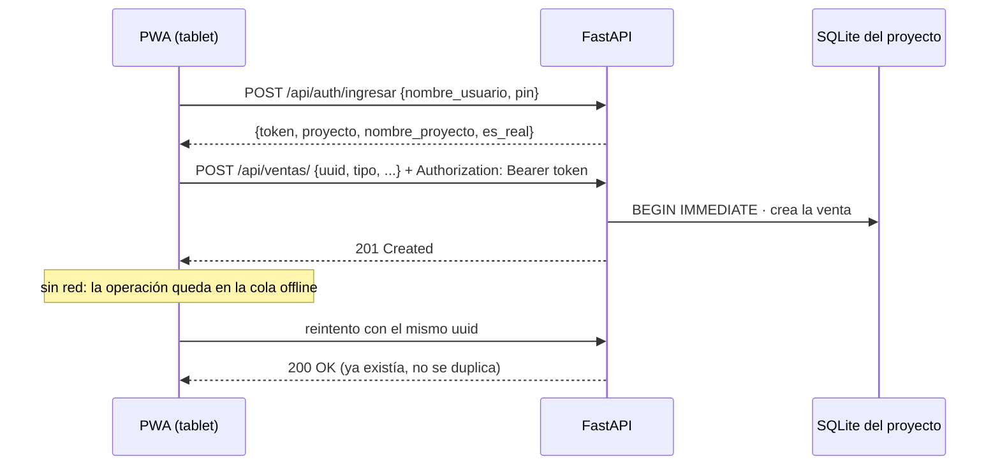

# 06 · API y MCP

> Contrato HTTP del backend (FastAPI) y estado de MCP. Última revisión: 2026-11-01.
> Fuente de verdad: `backend/main.py`, `backend/seguridad.py`, `backend/database.py` y `backend/modules/*/router.py`.
> Esquemas: `frontend/src/api/openapi.json`, exportado por `backend/exportar_openapi.py` y vigilado por
> `backend/tests/test_contrato.py`. Con el servidor en marcha, el OpenAPI completo está en `/docs` y `/openapi.json`.

## 1. Servidor

| Entorno | Cómo arranca | Dirección |
|---|---|---|
| Staging | `cd backend && uvicorn main:app --reload` + dev server de Vite (CORS: `MI_PUESTITO_ORIGENES`, por defecto `localhost:5173`) | `127.0.0.1`, puerto de uvicorn |
| Producción local | `MiPuestito.exe` (`backend/escritorio.py`) sirve API y frontend juntos | `127.0.0.1`, puerto libre que se recuerda en `puerto.txt` de la carpeta de datos |

- Las rutas `/api/*` se registran primero. Después, `/assets/*` y un comodín `/{ruta}` (fuera del esquema) devuelven la
  PWA construida (`frontend/dist/`), así que recargar `/ventas` abre la aplicación y no un 404.
- Cada módulo se monta por separado (`MODULOS` en `main.py`). Si uno falla al importarse, sus rutas no existen (404) y
  aparece en `modulos_degradados` de `/api/salud`; los demás siguen respondiendo.

## 2. Autenticación y convenciones

- **Token:** `Authorization: Bearer <proyecto>:<vence>:<firma>`, HMAC-SHA256 con `MI_PUESTITO_SECRETO`, válido 12 h. Cada token
  abre **solo** la base de su proyecto (`demo` o el real), nunca la de otro. Sin token o con token inválido: `401`.
- **Límite de intentos (D-04):** tras 5 PIN fallidos seguidos, `429` con `Retry-After`; la espera empieza en 30 s y se
  duplica con cada fallo, hasta 15 min.
- **Idempotencia (ADR-032):** toda escritura lleva un `uuid` generado en el dispositivo. Responde `201` si creó algo y `200`
  si ya existía (reintento de la cola offline).
- **`ocurrido_en`:** hora real de la operación en el dispositivo; la pone la app, nunca el usuario.
- **Escrituras serializadas (D-02):** las rutas que escriben usan `obtener_sesion_escritura` (`BEGIN IMMEDIATE`); las de
  lectura, `obtener_sesion`.
- **Paginación:** `limite` y `desde` en los listados (por defecto 50, máximo 200; productos: 100 y 500).
- **Errores:** `401` sesión, `422` validación de Pydantic, `429` intentos, `503` Asistente no disponible. Las reglas de
  negocio devuelven el código que fija `servicio.py` (`ErrorDeVenta`, `ErrorDeInventario`) con un `detail` legible.
- **Montos:** string decimal en soles (`"485.50"`); el frontend los convierte a céntimos en `api/contrato.ts` (ADR-033).

## 3. Endpoints REST

Valores de dominio: `tipo` = `orden_activa` | `fiado` | `venta_rapida`; `estado` = `abierta` | `pagada_cerrada` | `fiada` |
`pendiente_formalizar`; `metodo_pago` = `efectivo` | `yape_plin`; `unidad` = `unidad` | `kg` | `litro`.

### Salud y acceso (sin token)

| Método | Ruta | Entrada | Respuesta | Notas |
|---|---|---|---|---|
| GET | `/api/salud` | – | `{estado, modulos_degradados, eventos_con_fallas}` | Responde `ok` aunque haya módulos caídos; el humo del ejecutable exige `modulos_degradados == []` (ADR-029) |
| POST | `/api/auth/ingresar` | `IngresoEntrada {nombre_usuario, pin}` | `IngresoSalida {token, proyecto, nombre_proyecto, es_real}` | `401` credenciales, `429` espera |
| GET | `/api/auth/cuentas` | – | `CuentaVisible[] {nombre_usuario, nombre_proyecto, es_real}` | Para la pantalla de ingreso; nunca incluye PIN, hash ni sal |

### Dashboard (token)

| Método | Ruta | Respuesta | Notas |
|---|---|---|---|
| GET | `/api/dashboard/resumen` | `ResumenDashboard` | Día actual en hora de Lima y proyección de mañana; si un módulo no pudo leerse, su parte sale en cero y se nombra en `secciones_no_disponibles` |
| POST | `/api/dashboard/demo/reiniciar` | `204` | Vuelve a sembrar la práctica; con un negocio real → `403` |

### Ventas, clientes y fiado (token)

| Método | Ruta | Entrada | Respuesta | Notas |
|---|---|---|---|---|
| GET | `/api/ventas/` | `limite`, `desde`, `estado?` | `VentaSalida[]` | De la más reciente a la más antigua, con items |
| GET | `/api/ventas/abiertas` | – | `VentaSalida[]` | Panel de órdenes activas, en orden de apertura |
| GET | `/api/ventas/{uuid}` | – | `VentaSalida` | |
| POST | `/api/ventas/` | `VentaEntrada {uuid, tipo, nombre_orden?, cliente_uuid?, monto?, metodo_pago?}` | `ResultadoVenta {venta, avisos}` | Abre orden activa o fiado, o registra una venta rápida ya cobrada. Idempotente |
| DELETE | `/api/ventas/{uuid}` | – | `204` | Anula una orden abierta por error, solo si aún no tiene productos |
| POST | `/api/ventas/{uuid}/items` | `ItemEntrada {uuid, nombre_producto, monto, cantidad?, cantidad_num?, producto_uuid?}` | `ResultadoVenta` | Con `producto_uuid`, Inventario descuenta stock por evento. Idempotente |
| DELETE | `/api/ventas/{uuid}/items/{item_uuid}` | – | `ResultadoVenta` | |
| POST | `/api/ventas/{uuid}/cobrar` | `CobroEntrada {metodo_pago?}` | `ResultadoVenta` | Cierra como `pagada_cerrada` |
| POST | `/api/ventas/{uuid}/fiar` | `FiarEntrada {cliente_uuid?}` | `ResultadoVenta` | Cierra a crédito; suma a la deuda del cliente |
| POST | `/api/ventas/{uuid}/formalizar` | – | `ResultadoVenta` | Completa una venta rápida con su detalle; debe cuadrar con lo cobrado |
| GET | `/api/ventas/clientes` | `buscar?`, `limite`, `desde` | `ClienteSalida[]` | Orden alfabético |
| GET | `/api/ventas/clientes/{uuid}` | – | `ClienteConDeuda` | |
| POST | `/api/ventas/clientes` | `ClienteEntrada {uuid, nombre, telefono?, limite_credito?}` | `ClienteSalida` | Idempotente |
| PATCH | `/api/ventas/clientes/{uuid}` | `ClienteCambios {nombre?, telefono?, limite_credito?, quitar_limite?}` | `ClienteSalida` | |
| GET | `/api/ventas/fiados` | – | `ClienteConDeuda[]` | Clientes con deuda, del que más debe al que menos |
| POST | `/api/ventas/abonos` | `AbonoEntrada {uuid, cliente_uuid, monto, metodo_pago?}` | `AbonoSalida` (incluye `deuda_restante`) | Paga parte o todo un fiado. Idempotente |

### Inventario (token · ADR-031)

| Método | Ruta | Entrada | Respuesta | Notas |
|---|---|---|---|---|
| GET | `/api/inventario/productos` | `buscar?`, `solo_bajo_minimo`, `limite`, `desde` | `ProductoConEstado[]` | Incluye `bajo_minimo` y `descuadre` |
| POST | `/api/inventario/productos` | `ProductoEntrada {uuid, nombre, unidad?, precio_venta?, stock_inicial?, stock_minimo?, codigo_barras?, tiene_vencimiento?}` | `ProductoConEstado` | Idempotente |
| PATCH | `/api/inventario/productos/{uuid}` | `ProductoCambios` | `ProductoConEstado` | |
| GET | `/api/inventario/productos/{uuid}/movimientos` | `limite`, `desde` | `MovimientoSalida[]` | Por qué cambió el stock: ventas, compras y ajustes |
| POST | `/api/inventario/ajustes` | `AjusteEntrada {uuid, producto_uuid, contado, nota?}` | `AjusteSalida {producto, diferencia}` | Conteo físico: fija el stock y registra la diferencia |
| POST | `/api/inventario/mermas` | `MermaEntrada {uuid, producto_uuid, cantidad, nota?}` | `ProductoConEstado` | |
| GET | `/api/inventario/descuadres` | – | `ProductoConEstado[]` | Stock negativo: se vendió más de lo registrado |
| GET | `/api/inventario/conciliacion` | – | `Descuadre[]` | Control interno: debe estar siempre vacío (stock = Σ movimientos) |

### Compras (token · ADR-045)

| Método | Ruta | Entrada | Respuesta | Notas |
|---|---|---|---|---|
| GET | `/api/compras/proveedores` | `busqueda?`, `limite`, `desde` | `ProveedorSalida[]` | Por nombre, empresa o RUC |
| POST | `/api/compras/proveedores` | `ProveedorEntrada {uuid, nombre, empresa?, ruc? (11 dígitos), telefono?, categoria?}` | `ProveedorSalida` | `201`/`200`; RUC repetido → `409` |
| GET | `/api/compras/proveedores/{uuid}/frecuentes` | — | `ProductoFrecuente[] {nombre_producto, cantidad, monto, veces}` | Máx. 10 |
| GET | `/api/compras/ordenes` | `estado?` repetible, `limite`, `desde` | `OrdenCompraSalida[]` con items | |
| POST | `/api/compras/ordenes` | `OrdenEntrada {uuid, proveedor_uuid, estado? (borrador\|pendiente), fecha_estimada_llegada?, notas?, items (1–100) [{uuid, nombre_producto, cantidad?, monto}]}` | `ResultadoOrden {orden, avisos}` | `201`/`200`; el total lo calcula el servidor |
| PATCH | `/api/compras/ordenes/{uuid}/estado` | `{estado: pendiente\|en_camino}` | `ResultadoOrden` | Solo hacia adelante; atrás → `409` |
| POST | `/api/compras/ordenes/{uuid}/recepcion` | `RecepcionEntrada {items [{item_uuid, estado, producto_sustituto?, monto_sustituto?, cantidad_stock?}]}` | `ResultadoOrden` | Recalcula `monto_real`; publica `compra.item_recibido`; reescribir → `409` |
| POST | `/api/compras/ordenes/{uuid}/cerrar` | — | `ResultadoOrden` | Solo desde `recibida` |

### Respaldo (token · ADR-044)

| Método | Ruta | Entrada | Respuesta | Notas |
|---|---|---|---|---|
| GET | `/api/respaldo/copia` | — | Archivo `application/octet-stream` | `Cache-Control: no-store`. Solo del proyecto del token |
| POST | `/api/respaldo/restaurar` | Bytes de la copia en el cuerpo | `204` | `400` no sirve · `409` otro negocio o versión más nueva · `413` > 200 MB · `507` sin disco |

### Asistente (token)

| Método | Ruta | Entrada | Respuesta | Notas |
|---|---|---|---|---|
| POST | `/api/asistente/preguntar` | `PreguntaEntrada {mensaje (1–500), historial? [{rol: operador\|asistente, texto}] (≤ 12)}` | `RespuestaSalida {respuesta, acciones [{tipo: ir_a, pantalla, etiqueta}], id_respuesta, modelo}` | Responde con el mismo resumen que ve el operador. Seudonimiza resumen, pregunta e historial antes de salir al proveedor y restituye los nombres en la respuesta (ADR-034). `acciones` solo trae pantallas de la lista blanca (ADR-037). `503` si no hay proveedor configurado |
| POST | `/api/asistente/valoracion` | `ValoracionEntrada {id_respuesta, util}` | `204` | "Me sirvió" / "No me sirvió". Se guarda solo si el registro está activo (ADR-038) |
| GET | `/api/asistente/estado` | — | `EstadoAsistente {listo, puede_guardar_llave, llave_guardada}` | Nunca incluye la llave |
| POST | `/api/asistente/llave` | `LlaveEntrada {llave}` | `EstadoAsistente` | Solo modo local, Windows y desde el mismo equipo (`403`); mal copiada o rechazada → `400`, sin repetirla (ADR-043) |
| DELETE | `/api/asistente/llave` | — | `EstadoAsistente` | Mismas condiciones |

## 4. Proveedor de IA (salida del backend)

No es un endpoint de Mi Puestito, sino lo que el backend consume (ADR-036):

| Qué | Valor |
|---|---|
| Protocolo | `POST {MI_PUESTITO_IA_URL}/chat/completions`, compatible con OpenAI (`model`, `messages`, `max_tokens` 450, `temperature` 0.3) |
| NVIDIA NIM (hoy) | `https://integrate.api.nvidia.com/v1`, `Authorization: Bearer` con `NVIDIA_API_KEY` o la llave guardada (ADR-043) |
| Local (futuro) | `MI_PUESTITO_IA_PROVEEDOR=local` → `http://127.0.0.1:11434/v1` (Ollama) o la URL de llama.cpp |
| Orden de modelos | `MI_PUESTITO_IA_MODELOS` > `ia_modelos.json` (de `python -m ia.verificar`) > lista por defecto |
| Ajustes por familia | Nemotron: `chat_template_kwargs: {enable_thinking: false}` · gpt-oss: `reasoning_effort: low` (`ia/configuracion.py`) |
| Respuesta | Se quita `<think>…</think>` y el markdown en negrita; si el contenido es un borrador de razonamiento se descarta y se prueba el siguiente modelo; las líneas `ACCION: ir_a <pantalla>` (o la mención "pantalla fiados") se convierten en `acciones` |

## 5. MCP

**N/A por ahora.** Mi Puestito no expone un servidor MCP. Si se agrega un adaptador MCP, debe construirse sobre los
mismos servicios de los módulos (no duplicar reglas), heredar la autenticación por proyecto y documentarse aquí con el
esquema de cada herramienta.

## 6. Cómo se mantiene este contrato

1. Cambia un esquema o una ruta en `backend/modules/<modulo>/`.
2. `cd backend && python exportar_openapi.py` actualiza `frontend/src/api/openapi.json`.
3. `pytest` (incluye `test_contrato.py`) y `npm run test` (incluye `contrato.test.ts`) deben pasar.
4. Actualiza esta pestaña y ejecuta el sync de contexto del workspace.
