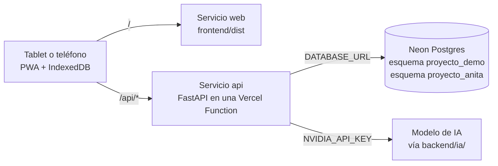

# Despliegue en Vercel

#arquitectura

> La versión en internet de Mi Puestito. Convive con el ejecutable de Windows ([[Distribucion-Escritorio]]): el
> mismo código, con PostgreSQL en vez de SQLite. Decisión 58 en [[Decisiones-Tecnicas]].

## Cómo queda armado

Un solo proyecto de Vercel con **Vercel Services** (`vercel.json` en la raíz):

| Servicio | Carpeta | Qué es | Ruta pública |
|---|---|---|---|
| `web` | `frontend/` | La PWA (Vite, React) | `/` |
| `api` | `backend/` | FastAPI (`main:app`), una Vercel Function | `/api/*` |

Todo bajo el mismo dominio: la PWA llama a `/api` sin CORS, igual que en el ejecutable. El frontend sigue siendo
offline-first ([[Sincronizacion-Offline]]): sin red se guarda en el dispositivo y se envía al volver.

## Qué cambia frente al programa local

- **Datos:** con `DATABASE_URL` (la inyecta Neon desde el Marketplace de Vercel) cada negocio vive en su propio esquema
  de PostgreSQL (`proyecto_demo`, `proyecto_anita`). Nunca se mezclan, igual que los archivos SQLite. Las escrituras de un
  negocio se atienden de a una con `pg_advisory_xact_lock` (lo que en SQLite hace `BEGIN IMMEDIATE`).
- **Migraciones:** corren solas al arrancar la función, con un candado para que dos instancias no choquen.
- **Disco:** en Vercel solo `/tmp` se puede escribir y se pierde. Nada que deba durar va ahí.
- **Ingreso:** el PIN del negocio real sale de su variable secreta en cada arranque (cambiarla cambia el PIN). El límite
  de intentos se comparte entre instancias en la tabla `public.mi_puestito_intentos`.
- **Respaldo de archivo:** no aplica; lo dice con un mensaje claro. Las copias las hace Neon (restauración a un momento).
- **Entorno:** en Vercel es `production` aunque nadie lo diga, y sin `MI_PUESTITO_SECRETO` la función no arranca.

## Variables de entorno en Vercel

| Variable | Tipo | Production | Preview (Staging) | Para qué |
|---|---|---|---|---|
| `DATABASE_URL` | La pone Neon | ✓ | ✓ (rama propia de Neon) | La base PostgreSQL |
| `MI_PUESTITO_SECRETO` | **Secret** | ✓ | ✓ (otro valor) | Firma las sesiones; 32+ caracteres: `python -c "import secrets; print(secrets.token_hex(32))"` |
| `MI_PUESTITO_ANITA_PIN` | **Secret** | ✓ | ✓ | PIN del negocio real (6 dígitos). Sin ella esa cuenta no aparece |
| `NVIDIA_API_KEY` | **Secret** | ✓ | ✓ | Llave del Asistente. Sin ella el Asistente dice que no está configurado y lo demás funciona |
| `MI_PUESTITO_DEMO` | Config | opcional | opcional | `0` quita la cuenta de práctica (PIN público 0000) |
| `MI_PUESTITO_IA_MODELOS` | Config | opcional | opcional | Orden de modelos, separados por coma |

Ninguna se escribe en el repositorio (es público, ADR-030). `vercel env pull` deja las de Development en `.env.local`,
que está ignorado.

## Staging y Producción

- **Staging = Preview:** cada push a una rama que no es `main` crea un despliegue de Preview. Con la integración de Neon
  configurada para crear una **rama de base por Preview**, lo que se pruebe ahí nunca toca los datos reales.
- **Producción = `main`:** solo recibe código ya probado en Preview.
- **Staging en la computadora:** `vercel dev --local` levanta los dos servicios con la misma configuración. Con
  `DATABASE_URL` apuntando a un PostgreSQL local se prueba igual que en la nube. Verificado el 2026-11-25 con
  PostgreSQL 16: migraciones, ingreso con el PIN del secreto, venta, Asistente con memoria y Análisis.

## Pasos para el primer despliegue

1. Importar el repositorio en Vercel (el `vercel.json` de la raíz define los servicios).
2. Agregar Neon desde el Marketplace y conectarlo a Production y Preview, con rama por Preview.
3. Crear `MI_PUESTITO_SECRETO` y `MI_PUESTITO_ANITA_PIN` como Secret (valores distintos en Preview y Production).
4. Desplegar una rama de Preview y revisar `/api/salud` (`modulos_degradados` vacío) y el ingreso.
5. Agregar `NVIDIA_API_KEY` como Secret y probar el Asistente en Preview.
6. Fusionar a `main` para Producción.

## Pendiente de confirmar en el primer despliegue

- El build del frontend lee los tokens de diseño de `docs/design-system/` (fuera de `frontend/`). En `vercel dev` funciona;
  falta verlo en un build real de Vercel.
- `/api/salud` y el log del primer arranque: confirmar que las migraciones corren y que ningún módulo queda degradado.
